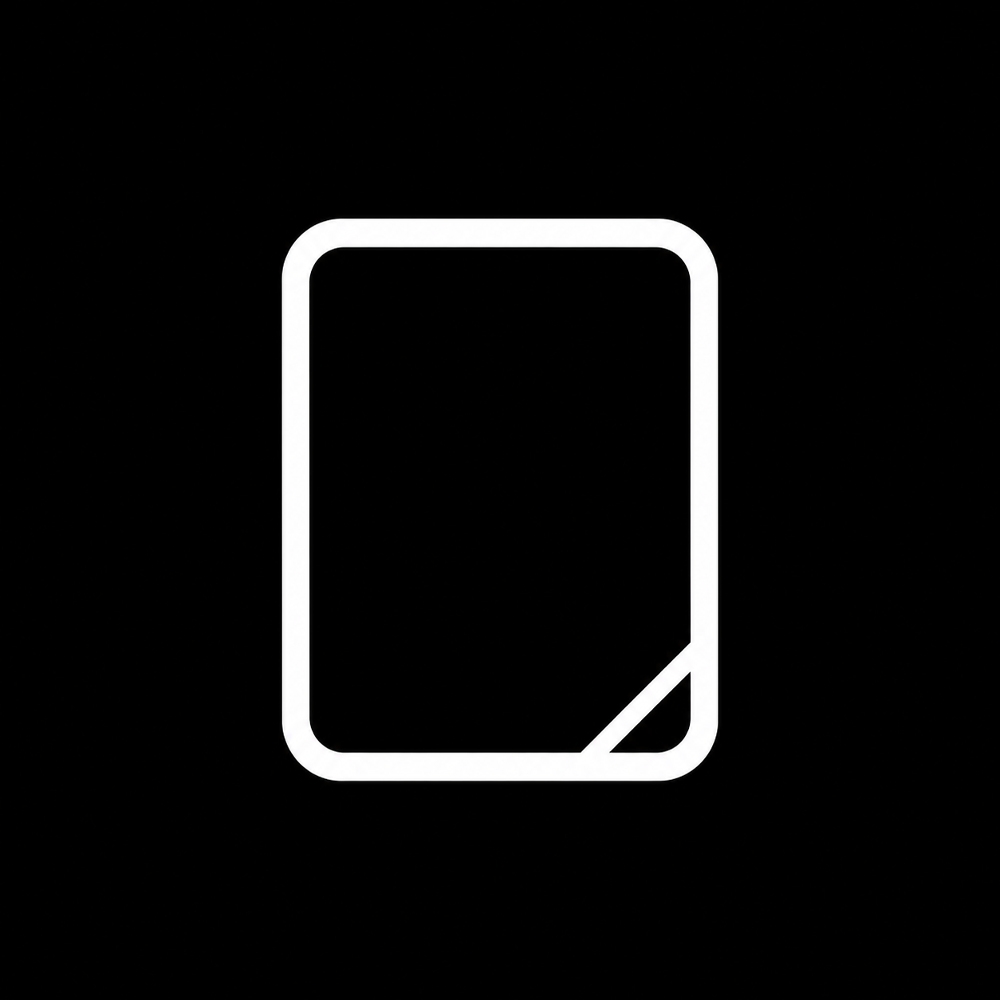

<p align="center">
  
</p>

<h1 align="center">映壁 · Pura Wallpaper</h1>
<p align="center">面向 HarmonyOS 手机的 Wallhaven 壁纸浏览、裁剪和导出工具</p>

**当前版本 `1.0.9`** · ArkTS / ArkUI · HarmonyOS API 26

## 功能

- 浏览 Wallhaven 热门和最新壁纸，支持关键词搜索、分页和 SFW、Sketchy、NSFW 多选筛选。默认仅选中 SFW，NSFW 需要有效的 API Key。
- 浏览 `pangdunqing` 的公开收藏集，以及当前 API Key 有权访问的私有收藏集。
- 查看原图，通过拖动、双指缩放或滑块调整选区，点击裁剪图可全屏预览。
- 自动识别机型和当前活动屏幕的物理像素尺寸，将裁剪结果导出为相应尺寸的 JPEG。
- 通过系统保存按钮将图片写入图库，随后可在图库中将图片设为桌面或锁屏壁纸。
- 跟随系统深浅色，壁纸列表和横向预览会随窗口宽度调整布局。

## 在 DevEco Studio 中运行

需要安装带有 HarmonyOS API 26 SDK 的 DevEco Studio。项目的包名为 `com.pangdun.purawallpaper`，入口模块为 `entry`。

1. 在 DevEco Studio 中打开本仓库根目录，等待工程同步。
2. 在项目结构的 **Signing Configs** 中配置本机开发签名。
3. 选择 API 26 的 HarmonyOS 手机或模拟器，运行 `entry`。连接真机时，在设备上开启 USB 调试并确认连接授权。

也可以在项目根目录通过命令行构建 HAP。

**Windows PowerShell**

```powershell
$env:DEVECO_HOME = 'C:\Program Files\Huawei\DevEco Studio'
$env:DEVECO_SDK_HOME = Join-Path $env:DEVECO_HOME 'sdk'
$env:JAVA_HOME = Join-Path $env:DEVECO_HOME 'jbr'
$env:NODE_HOME = Join-Path $env:DEVECO_HOME 'tools\node'
$env:Path = "$env:JAVA_HOME\bin;$env:NODE_HOME;$env:DEVECO_HOME\tools\ohpm\bin;$env:Path"

& "$env:DEVECO_HOME\tools\ohpm\bin\ohpm.bat" install
& "$env:DEVECO_HOME\tools\hvigor\bin\hvigorw.bat" assembleHap --mode module -p product=default -p buildMode=release --no-daemon
```

将 `DEVECO_HOME` 改为本机的实际安装目录。

**macOS**

```sh
export DEVECO_HOME="/Applications/DevEco-Studio.app/Contents"
"$DEVECO_HOME/tools/node/bin/node" scripts/build.mjs
```

未配置签名时，默认产物为 `entry/build/default/outputs/default/entry-default-unsigned.hap`。安装到手机前需要使用与应用包名和目标设备匹配的开发签名。

## 使用

1. 在 **发现** 中浏览壁纸或输入关键词搜索。
2. 如需查看有权限的私有收藏或启用 NSFW，在 [Wallhaven 账户设置](https://wallhaven.cc/settings/account) 获取 API Key，通过首页右上角的齿轮进入设置并保存。
3. 打开壁纸并调整裁剪范围，点击裁剪图检查全屏效果。
4. 点击 **生成壁纸**，再用系统 **保存图片** 按钮写入图库。在图库中打开图片即可设置壁纸。

API Key 通过系统 AssetStoreKit 保存，仅用于 Wallhaven API 的 `X-API-Key` 请求头。图片 CDN 请求不携带凭据。在应用设置中留空保存可删除已保存的 Key。

## 源码结构

| 目录 | 内容 |
| --- | --- |
| [`AppScope/`](AppScope/) | 应用标识、版本和图标 |
| [`entry/src/main/ets/pages/`](entry/src/main/ets/pages/) | 页面入口及状态 |
| [`entry/src/main/ets/components/`](entry/src/main/ets/components/) | 发现、预览裁剪和设置界面 |
| [`entry/src/main/ets/core/`](entry/src/main/ets/core/) | API 数据校验和裁剪几何 |
| [`entry/src/main/ets/services/`](entry/src/main/ets/services/) | Wallhaven 请求、设备信息、凭据及图片处理 |
| [`tests/`](tests/) | 数据、裁剪、图片处理、设备与窗口测试 |

## 自动测试

测试从项目的 ArkTS 源码转译，编译器来自 DevEco Studio 的 SDK。请在项目根目录运行。

**Windows PowerShell**

```powershell
$env:DEVECO_HOME = 'C:\Program Files\Huawei\DevEco Studio'
$testFiles = (Get-ChildItem .\tests\*.test.mjs).FullName
& "$env:DEVECO_HOME\tools\node\node.exe" --test $testFiles
```

如果 DevEco Studio 安装在其他位置，请将 `DEVECO_HOME` 改为实际安装目录。

**macOS**

```sh
export DEVECO_HOME="/Applications/DevEco-Studio.app/Contents"
"$DEVECO_HOME/tools/node/bin/node" --test tests/*.test.mjs
```

40 项自动测试通过。图片与窗口测试使用平台模拟接口。历史真机验收在 Pura X（VDE-AL00）上进行，验证了主屏 `1320 × 2120` 导出、裁剪预览和深浅色切换。测试范围及设备记录见 [验收报告](docs/testing/2026-11-17-pura-wallpaper-test-report.md)。

## 数据来源与授权

壁纸来自 Wallhaven，图片版权归各自作者。使用、分享或再分发图片时请遵守对应授权。[Wallhaven API 文档](https://wallhaven.cc/help/api)

当前源码包未附带项目许可证。
